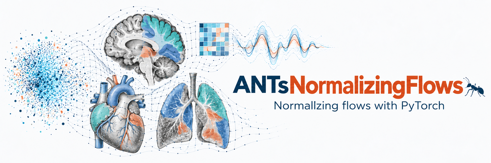

<div align="center">



<!-- AI-generated conceptual artwork; not an ANTsNormalizingFlows inference result. -->

# ANTsNormalizingFlows

### Normalizing flows with PyTorch, powered by ANTsX

Density estimation · Generative modeling · Conditional flows · 1-D, 2-D & 3-D Glow

[](pyproject.toml)
[](https://pytorch.org/)
[](LICENSE)
[](https://github.com/ANTsX/ANTsNormalizingFlows/actions/workflows/pytest.yaml)

[Documentation](https://antsnormalizingflows.readthedocs.io/en/latest/) · [Examples](examples/README.md) · [API guide](https://antsnormalizingflows.readthedocs.io/en/latest/api.html) · [Citation](#citation)

</div>

---

**ANTsNormalizingFlows provides PyTorch building blocks for density estimation and generative modeling.** Compose transformations, fit probability densities to observations, and generate samples from learned models, from feature vectors to volumetric data.

The package builds on [normflows](https://github.com/VincentStimper/normalizing-flows) by Vincent Stimper and collaborators, extending it with convolutional flows for signals, images, and volumes. It is part of the [ANTsX](https://github.com/ANTsX) ecosystem and supplies flow components used by [ANTsTorch](https://github.com/ANTsX/ANTsTorch/). The Python package and import name is **`antsnormflows`**.

## What you can do

| Area | Capabilities | Start here |
| --- | --- | --- |
| **Vector density models** | Real NVP, affine autoregressive flows, neural spline flows, planar, radial, and residual transformations | [Training tutorial](https://antsnormalizingflows.readthedocs.io/en/latest/getting_started.html) |
| **Signals & periodic data** | 1-D coupling and Glow blocks, circular padding, circular spline flows | [1-D convolutional example](examples/conv_flow_1d.ipynb) |
| **Images & volumes** | 2-D and 3-D Glow blocks, multiscale models, per-axis squeezing, spatial/temporal kernels | [3-D Glow](examples/glow_3d.ipynb) · [Factorized 3-D Glow](examples/factorized_glow_3d.ipynb) |
| **Conditional modeling** | Context-conditioned affine and spline models, class-conditional multiscale flows | [Example guide](examples/README.md) |
| **Training & evaluation** | Likelihood and divergence objectives, sampling, latent transforms, checkpoint saving and loading | [Training conventions](https://antsnormalizingflows.readthedocs.io/en/latest/training.html) |

Layer support varies by direction and objective. For example, radial flows do not implement an inverse, and planar flows support an inverse only for the leaky-ReLU variant. Use compatible layers for likelihood training and density evaluation.

## Installation

Requires **Python 3.10+**, **NumPy**, and **PyTorch**. A GPU is optional. From a terminal:

```bash
git clone https://github.com/ANTsX/ANTsNormalizingFlows.git
cd ANTsNormalizingFlows
python3 -m venv .venv
source .venv/bin/activate
python -m pip install --upgrade pip
python -m pip install -e .
```

On Windows, activate the environment with `.venv\Scripts\activate` in Command Prompt. For a particular accelerator configuration, install the appropriate PyTorch build before installing this package.

For a direct installation without a working checkout:

```bash
python -m pip install git+https://github.com/ANTsX/ANTsNormalizingFlows.git
```

See the [installation guide](https://antsnormalizingflows.readthedocs.io/en/latest/installation.html) for optional dependencies and environment checks.

## Quick start

Train a small Real NVP model on a synthetic two-dimensional Gaussian mixture, then evaluate densities and draw samples. This example runs on CPU and requires no external data or pretrained weights.

```python
import torch
import antsnormflows as nf

torch.manual_seed(42)
base = nf.distributions.base.DiagGaussian(2)
flows = []
for _ in range(4):
    conditioner = nf.nets.MLP([1, 64, 64, 2], init_zeros=True)
    flows.append(nf.flows.AffineCouplingBlock(conditioner))
    flows.append(nf.flows.Permute(2, mode="swap"))

model = nf.NormalizingFlow(base, flows)
optimizer = torch.optim.Adam(model.parameters(), lr=1e-3)
centers = torch.tensor([[-2.0, 0.0], [2.0, 0.0]])

model.train()
for step in range(100):
    labels = torch.randint(2, (128,))
    x = centers[labels] + 0.5 * torch.randn(128, 2)
    optimizer.zero_grad(set_to_none=True)
    loss = model.forward_kld(x)
    if not torch.isfinite(loss):
        raise RuntimeError("Non-finite training loss")
    loss.backward()
    optimizer.step()

model.eval()
with torch.no_grad():
    samples, sample_log_prob = model.sample(256)
    log_prob = model.log_prob(samples)
    reconstructed = model(model.inverse(samples))

print("Sample shape:", tuple(samples.shape))  # (256, 2)
print("Log-density shape:", tuple(log_prob.shape))  # (256,)
print("Round-trip error:", (samples - reconstructed).abs().max().item())
```

`forward_kld(x)` returns the mean negative log-likelihood for observations. `sample(n)` returns samples and their log densities; `log_prob(x)` evaluates one log density per observation. This short training run illustrates the API; it does not establish convergence.

For `NormalizingFlow`, `model(z)` maps latent coordinates to data and `model.inverse(x)` maps data to latent coordinates. `MultiscaleFlow` has a different calling convention: `model(x)` returns per-observation negative log-likelihoods. See the [complete tutorial](https://antsnormalizingflows.readthedocs.io/en/latest/getting_started.html) for validation and checkpoint examples.

## Run the examples

From the repository root:

```bash
python -m pip install -e '.[examples]'
python -m jupyterlab examples
```

The [example guide](examples/README.md) describes the notebooks, data requirements, and command-line VAE scripts. Start with the synthetic [1-D convolutional](examples/conv_flow_1d.ipynb), [3-D Glow](examples/glow_3d.ipynb), or [factorized 3-D Glow](examples/factorized_glow_3d.ipynb) notebooks for short CPU-compatible training and reconstruction checks. The legacy Glow and VAE examples download CIFAR-10 and MNIST, respectively.

Convolutional tensors use channels-first layouts: `(batch, channels, length)`, `(batch, channels, height, width)`, or `(batch, channels, depth, height, width)`. Before sampling from a `MultiscaleFlow`, call `inverse_and_log_det` on a representative batch to populate its shape cache, including after loading a checkpoint. See the [example API notes](examples/README.md#current-api-details) for further conventions.

## Documentation & development

- **[Documentation](https://antsnormalizingflows.readthedocs.io/en/latest/)** — installation, training, examples, and API reference.
- **[Training conventions](https://antsnormalizingflows.readthedocs.io/en/latest/training.html)** — objectives, tensor shapes, numerical considerations, and resumable checkpoints.
- **[Contributing](CONTRIBUTING.md)** — contribution and licensing guidelines.
- **[GitHub Issues](https://github.com/ANTsX/ANTsNormalizingFlows/issues)** — questions and bug reports; include a minimal example and package versions.

Install the relevant extras to run the tests or build the documentation:

```bash
python -m pip install -e '.[test,docs]'
python -m pytest
python -m sphinx -b html docs /tmp/antsnormflows-docs
```

## License & acknowledgments

ANTsX contributions are licensed under Apache 2.0. Original code inherited from `normflows` retains its MIT license; see [LICENSE](LICENSE) for details. We acknowledge Vincent Stimper and the `normflows` contributors for the original implementation.

## Citation

If you use `antsnormflows`, please cite the corresponding papers:

* Stimper et al. (2023). *normflows: A PyTorch Package for Normalizing Flows*.
  Journal of Open Source Software, 8(86), 5361,
  [JOSS](https://doi.org/10.21105/joss.05361).

    <details>
    <summary>BibTeX</summary>

    ```bibtex
    @article{Stimper2023,
      author = {Stimper, Vincent and Liu, David and Campbell, Andrew and Berenz, Vincent and Ryll, Lukas and Schölkopf, Bernhard and Hernández-Lobato, José Miguel},
      title = {normflows: A PyTorch Package for Normalizing Flows},
      journal = {Journal of Open Source Software},
      volume = {8},
      number = {86},
      pages = {5361},
      publisher = {The Open Journal},
      doi = {10.21105/joss.05361},
      url = {https://doi.org/10.21105/joss.05361},
      year = {2023}
    }
    ```

    </details>

* Tustison et al. (2026). *Deep Computational Anatomy via Latent-Aligned Multiview
  Normalizing Flows*. [bioRxiv](https://www.biorxiv.org/content/10.64898/2026.05.05.723039v1).

  <details>
  <summary>BibTeX</summary>

  ```bibtex
  @article{Tustison2026.05.05.723039,
    author = {Tustison, Nicholas James and Avants, Brian B. and Cook, Philip A. and Gee, James C. and Stone, James R.},
    title = {Deep Computational Anatomy via Latent-Aligned Multiview Normalizing Flows},
    elocation-id = {2026.05.05.723039},
    year = {2026},
    doi = {10.64898/2026.05.05.723039},
    publisher = {Cold Spring Harbor Laboratory},
    url = {https://www.biorxiv.org/content/early/2026/05/10/2026.05.05.723039},
    eprint = {https://www.biorxiv.org/content/early/2026/05/10/2026.05.05.723039.full.pdf},
    journal = {bioRxiv}
  }
  ```
  </details>

